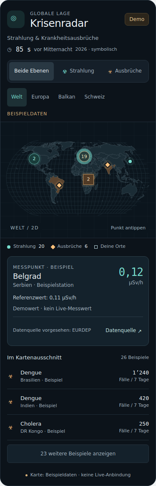

# Worldmeter – Krisenradar für Home Assistant

Eine dunkle, auf dem Smartphone bedienbare 2D-Weltkarte für Strahlung und Krankheitsausbrüche.

**Version 1.0.0 ist eine installierbare Demo. Alle Messwerte, Beispielstationen und Fallzahlen sind erfunden und sichtbar gekennzeichnet. Es gibt noch keine Live-Datenanbindung.** Die Doomsday Clock zeigt den veröffentlichten, symbolischen Stand für 2026: 85 Sekunden vor Mitternacht; sie ist kein laufender Countdown.



## Funktionen

- Umschaltbare Ebenen: beide, Strahlung, Ausbrüche.
- Welt, Europa, Balkan und Schweiz als Start- und Schnellansichten.
- Vergrössern gruppierter Kartenpunkte, Details durch Antippen.
- Referenzwerte und gemeldeter Zeitraum pro Beispiel, Links zu vorgesehenen Datenquellen.
- Statische Ortsmarkierungen Aranđelovac und Oberbipp.
- Echte geografische Ländergrenzen; Karte und Geometrie sind im Download enthalten.
- Kein API-Schlüssel und kein zusätzlicher Python-Dienst nötig. Die Demo funktioniert offline.
- Mehrere unabhängige Karten pro Dashboard, ohne Änderungen an der Weltlage-Integration.

## Installation im privaten Repository

Das Repository ist aktuell privat. Die Downloads sind nach Anmeldung mit einem berechtigten GitHub-Konto erreichbar. Verwende dafür die **manuelle Installation** unten. Der Download liegt zusätzlich unter `downloads/ha-worldmeter-1.0.0.zip`, sodass er auch vor Fertigstellung des Releases verfügbar ist.

Das HACS-Manifest ist vorbereitet. Für die reguläre Installation als HACS Custom Repository muss das Repository öffentlich erreichbar sein; die Sichtbarkeit wird durch dieses Projekt nicht verändert.

## Installation mit HACS bei öffentlich erreichbarem Repository

1. In HACS das Menü **Benutzerdefinierte Repositories** öffnen.
2. `https://github.com/AshenSage/ha-worldmeter` hinzufügen; Kategorie **Dashboard** wählen.
3. **Krisenradar Card** herunterladen. Das Repository ist ein Custom Repository; es ist nicht automatisch Teil des HACS-Standardkatalogs.
4. Browser bzw. Companion App neu laden.
5. Im Dashboard eine manuelle Karte hinzufügen:

```yaml
type: custom:krisenradar-card
title: Krisenradar
region: world
layer: all
max_items: 3
show_clock: true
demo: true
```

HACS sollte die Ressource registrieren. Falls die Karte nicht gefunden wird, unter **Einstellungen → Dashboards → Ressourcen** prüfen, ob `/hacsfiles/ha-worldmeter/krisenradar-card.js` mit Typ **JavaScript-Modul** vorhanden ist. Für die Ressourcenverwaltung gegebenenfalls den erweiterten Modus im Benutzerprofil einschalten. Nicht zusätzlich die manuelle Ressource laden, wenn HACS verwendet wird.

## Manueller Download

1. Im GitHub-Release bzw. unter `downloads/` die Datei `ha-worldmeter-1.0.0.zip` oder direkt die JS-Datei `krisenradar-card.js` aus dem Repository herunterladen.
2. Die JS-Datei nach `/config/www/krisenradar-card.js` kopieren. Die übrigen ZIP-Dateien sind Dokumentation und Vorschau; sie müssen nicht nach Home Assistant kopiert werden.
3. Unter **Einstellungen → Dashboards → Ressourcen** hinzufügen:

```yaml
url: /local/krisenradar-card.js?v=1.0.0
type: module
```

4. Die oben gezeigte Karten-YAML einfügen und den Browser neu laden.

Wurde der Ordner `www` neu erstellt, kann ein Home-Assistant-Neustart nötig sein. Nach einem manuellen Update die Versionsangabe in der Ressourcen-URL ändern, damit Browser-Caches die neue Datei laden.

## Optionen

| Option | Standard | Bedeutung |
| --- | --- | --- |
| `title` | `Krisenradar` | Kartentitel |
| `region` | `world` | `world`, `europe`, `balkan`, `swiss` |
| `layer` | `all` | `all`, `radiation`, `outbreak` |
| `max_items` | `3` | Anfangs sichtbare Listeneinträge, Ganzzahl von 1 bis 10 |
| `show_clock` | `true` | Symbolische Doomsday Clock anzeigen |
| `demo` | `true` | In 1.0.0 ist nur `true` unterstützt; `false` führt zu einer ausdrücklichen Fehlermeldung |

Für den Start im Balkan `region: balkan` verwenden. Vollständige Beispiele liegen unter `examples/`.

## Vorschau ohne Home Assistant

`preview.html` aus dem ZIP herunterladen und im Browser öffnen. Die Datei enthält die vollständige Demo und benötigt weder einen lokalen Server noch Internetzugang. Die dort vereinfachten Symbolzeichen werden in Home Assistant durch dessen native Icons ersetzt.

## Live-Daten: noch nicht enthalten

Geplant sind passende Strahlungsdatenquellen und WHO-/ECDC-Ausbruchsmeldungen. Dafür müssen Schnittstellen, Nutzungsbedingungen, lokale Stationsabdeckung und Datenfrische zunächst geprüft werden. Links in der Demo führen zu allgemeinen Datenquellenseiten, nicht zu den erfundenen Beispielstationen oder Ausbruchsberichten.

Ein leeres Kartenfeld oder ein fehlender Bericht wäre auch bei einer späteren Live-Version keine Entwarnung. Die Karte ist kein behördliches Warnsystem und berechnet keine Atomkriegswahrscheinlichkeit. Für Krankheitsfälle werden Zeitraum und Quelle benötigt; Fälle verschiedener Krankheiten und Meldezeiträume werden nicht als globaler Gesamtwert zusammengezählt.

## Entwicklung

Die Quellen liegen unter `src/`, die lokal eingebundenen Abhängigkeiten unter `vendor/`. Einmal `npm install` für die Browser-Testabhängigkeit ausführen.

```bash
npm run build
npx playwright install chromium
npm test
npm run package
```

`scripts/build.mjs` erstellt die direkt installierbare JS-Datei und die eigenständige Vorschau. Der Build selbst benötigt keine npm-Pakete und keinen Netzwerkzugriff. Das Paket und Prüfsummen werden unter `artifacts/` erzeugt.

## Lizenzen und Quellen

Eigener Code: MIT. D3: ISC. Kartendaten über `@d3-maps/atlas` / Natural Earth: siehe [THIRD_PARTY_NOTICES.md](THIRD_PARTY_NOTICES.md).

- [Home Assistant Custom Cards](https://developers.home-assistant.io/docs/frontend/custom-ui/custom-card/)
- [HACS Dashboard-Repositories](https://www.hacs.dev/docs/publish/plugin/)
- [Doomsday Clock, Stand 2026](https://thebulletin.org/doomsday-clock/2026-statement/)
- [EURDEP](https://remap.jrc.ec.europa.eu/), [NAZ-Messnetze](https://www.naz.ch/themen/messnetze), [WHO Disease Outbreak News](https://www.who.int/emergencies/disease-outbreak-news)
